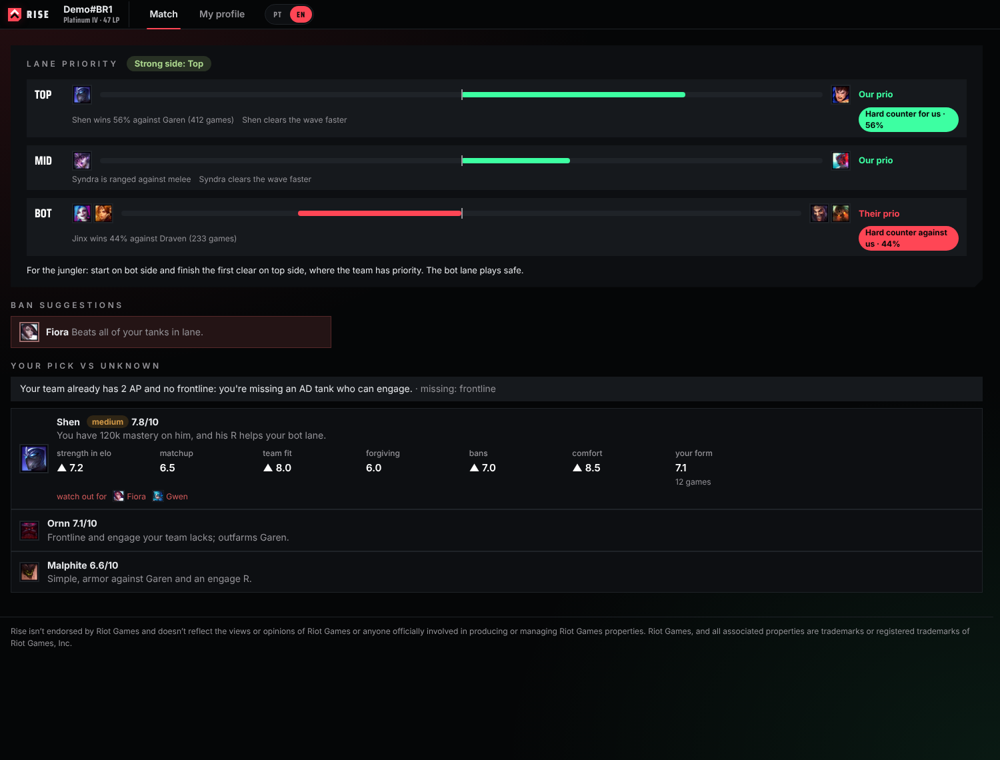
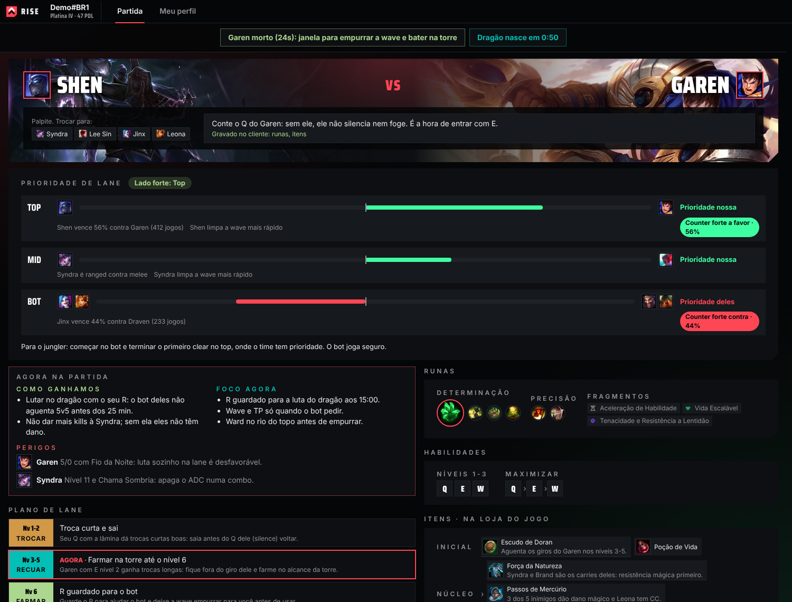
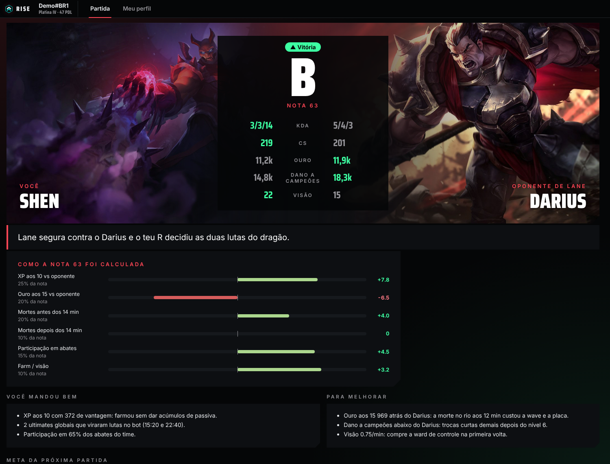
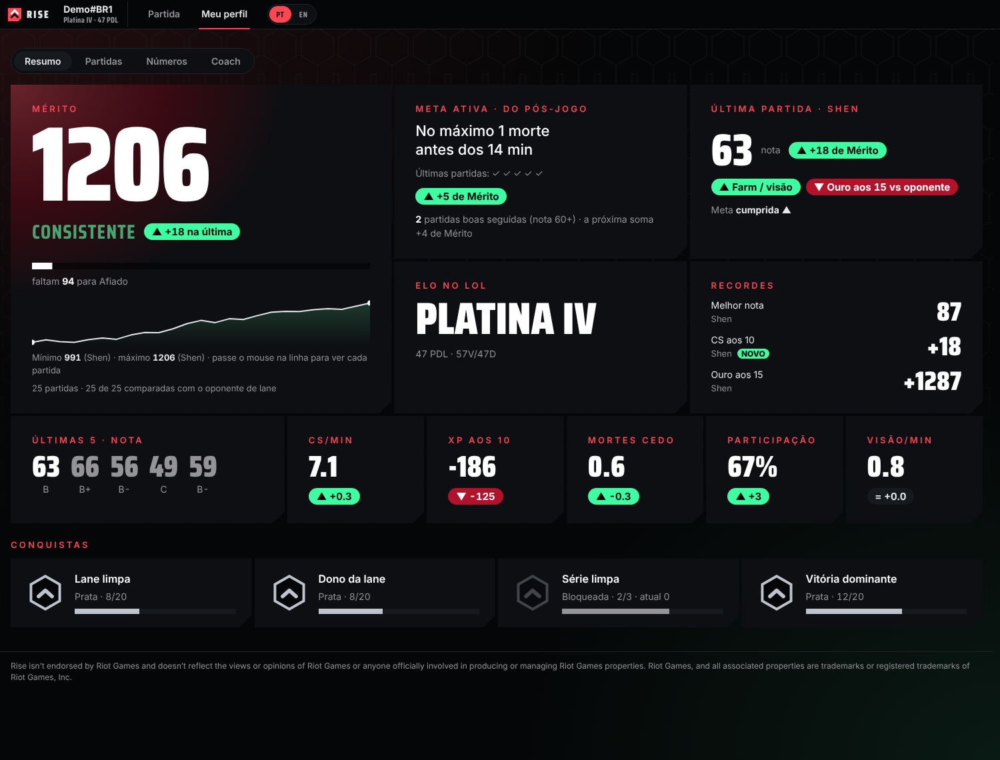
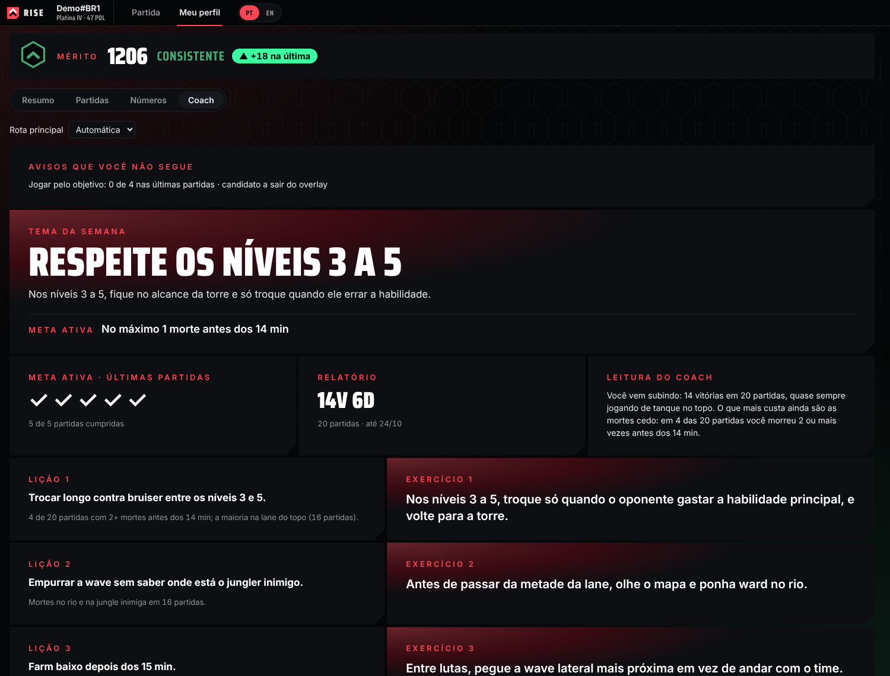

  

<h1 align="center">Rise</h1>

  <b>A League of Legends coach that lives next to your client.</b> 
  Plan every lane before it starts, read the game while you play it, and learn from your own matches after.

  
  

  

---

## What it does

| Before the game | During the game | After the game |
|---|---|---|
| **Lane priority** for every lane: who pushes first, hard counters and the strong side for the jungler. | **Short, glanceable reminders** from what you can already see: objective timers, trade windows, the next item. | **A grade that tracks winning**, built from your lane, deaths, objectives and gold, not from your KDA. |
| **Pick suggestions** from real high-elo results, your comfort and your team's needs. | **Your habit for this game** on screen, with how close you are to the goal. | **Mérito**, Rise's own measure of how well you play, that rises with good games even when you lose. |
| **A plan for your lane**: phase by phase posture, power spikes, runes, items and skill order, written to the client for you. | **Wards for your role**, checked against the current patch. | **A review** of what went well, what to fix and one focus for the next game. |

  
  

  
  

## Every role, two languages

Top, jungle, mid, ADC and support each get their own coaching notes, live alerts and ward tips. The whole app, including the coach's texts, is available in **Portuguese (Brazil)** and **English**.

## Get started

1. **[Download Rise for Windows](https://github.com/lucaskarsten/rise/releases/latest)** and run the installer. It lives in the tray and opens with the League client.
2. **Add a free AI key** in *Settings → Get your free key*: pick Groq, Gemini or Mistral, follow the three steps and paste the key. Rise recognizes it and tests it before saving.
3. **Play.** Rise picks up your champion select, your game and your post-game on its own.

Rise updates itself in the background when a new version is out.

## Fair play

- Rise **never reads or changes game memory** and never plays or clicks for you.
- It only shows what you can already see in the game or in the client.
- Suggestions explain *why*; you decide.
- No alternative ranking or MMR: Mérito is personal and never compared with the ladder.

## Privacy

- Your matches, reviews and settings stay **on your computer** (`%APPDATA%\Rise`).
- High-elo numbers (win rates, matchups, builds) are **aggregated** and published in [`data/`](data/) with no player or match identifiers.
- AI keys you add stay in a local file and are only sent to the provider you chose.
- Read the full [Privacy Policy](https://lucaskarsten.github.io/rise/privacy.html) and [Terms of Service](https://lucaskarsten.github.io/rise/terms.html).

## What lives in this repository

| Path | What |
|---|---|
| `index.html`, `terms.html`, `privacy.html`, `img/` | The [website](https://lucaskarsten.github.io/rise/) |
| `data/` | High-elo numbers the app downloads, refreshed by the collector |
| `riot.txt` | Riot Developer Portal verification |
| [Releases](https://github.com/lucaskarsten/rise/releases) | The Windows installer and its automatic updates |

The app's source code is kept in a private repository.

---

Rise isn't endorsed by Riot Games and doesn't reflect the views or opinions of Riot Games or anyone officially involved in producing or managing Riot Games properties. Riot Games, and all associated properties are trademarks or registered trademarks of Riot Games, Inc.
